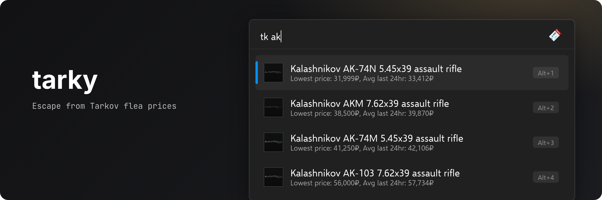

<!-- generated by readwright from docs/README.md.j2; edit the template, not this file -->


# Tarky

Look up Escape from Tarkov items and flea market prices from Flow Launcher.

[](https://github.com/Garulf/Tarky/actions/workflows/tests.yml) [](https://github.com/Garulf/Tarky/releases/latest)

[](https://www.buymeacoffee.com/garulf) [](https://github.com/sponsors/Garulf)

## Features

* **Every item in the game.** Weapons, meds, barter items, keys and the rest, straight from [tarkov.dev](https://tarkov.dev).
* **Flea market prices at a glance.** The lowest current offer and the 24 hour average, in roubles.
* **One key to the details.** `Enter` opens the item's page on tarkov.dev.
* **Partial names and initials.** `tk salewa` finds the Salewa first aid kit, `tk cfak` the Car first aid kit.

## Usage

Type `tk` followed by part of an item name:

```
tk ak
```


Prices show as `N/A` for items that can't be sold on the flea market.


The item list is cached for five minutes, so prices can lag the flea market by that much.

## Installation

Download `Tarky-<version>.zip` from the [latest release](https://github.com/Garulf/Tarky/releases/latest) and unzip it into
`%appdata%\FlowLauncher\Plugins`, then restart Flow Launcher.

Pre-releases of the next version are published from the open release PR on the
[releases page](https://github.com/Garulf/Tarky/releases) for testing. Flow Launcher won't offer them as updates.

## Requirements

* Flow Launcher 1.17.0 or newer
* Python 3.8 or newer, which Flow Launcher can install for you

## Changelog

See [CHANGELOG.md](CHANGELOG.md) for the full history.
